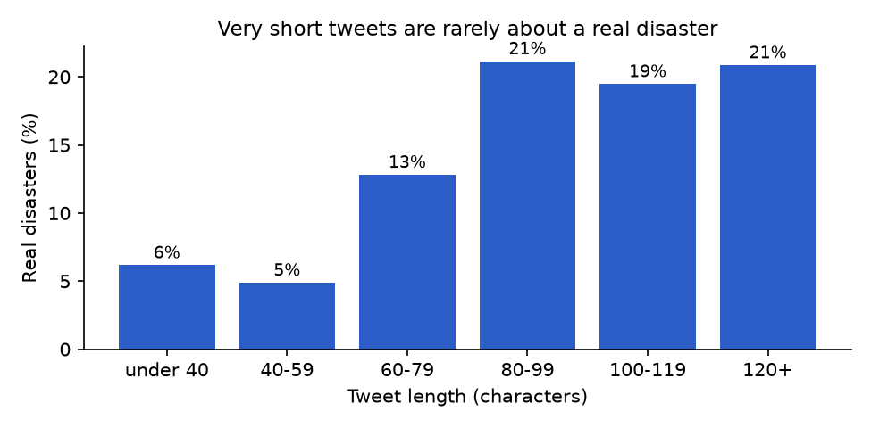

::: {.callout-note}
## Who this guide is for
No knowledge of data science, statistics or programming needed. Technical words are explained when they
first appear and in the [Glossary](#glossary).
:::

# The question in one paragraph

Every day people post millions of short messages ("tweets") on Twitter (now called X). Some of them report a
real emergency: *"China sinkhole: Six killed as ground swallows bus"*. Many more only *sound* like one: *"my
phone is on fire"*, *"this traffic is a disaster"*, *"I'm dying to see that movie"*. This project teaches a
computer to tell the two apart. You give it a tweet, and it answers with a **probability**, a number between 0
and 1, that the tweet is about a real disaster. 0.9 means "almost certainly a real disaster", 0.1 "almost
certainly not".

# Why it matters

Imagine you work in an emergency control room. When an earthquake or a wildfire starts, people often post about
it before any official report arrives, so social media can be an early warning. But nobody can read millions of
messages, and a simple word search for "fire" or "disaster" would bury you in jokes, song reviews and
complaints about traffic.

A program that sorts real reports from figures of speech would let people look at the few messages that matter.
It's the same idea as a spam filter in your e-mail, which learned to tell junk mail from real mail by looking at
many examples. This project is a small, honest version of such a filter, and it also shows how to check whether
a filter like this can be trusted.

The task comes from **Kaggle**, a website where people practise and compete at building such programs. Its
competition *"Natural Language Processing with Disaster Tweets"* gives everyone the same labelled tweets and
scores everyone's predictions on tweets nobody has seen the answers to.

# The data, explained

**Where it comes from.** The project uses a public collection of **11,370 tweets** shared on Kaggle (called
`vstepanenko/disaster-tweets`), collected on 14 January 2020 and placed in the public domain by its author. Each
tweet was found by searching for a disaster-related word, and a person then read it and marked it as a real
disaster or not. A copy is included with the project, so you don't need an account to use it.

**What one row contains.** Every tweet is one row of a table with five columns:

- **`id`**: just a row number.
- **`keyword`**: the search word the tweet was found with, such as `sinkhole`, `flood` or `ablaze` (219
  different ones). In some rows it's written oddly, like `buildings%20on%20fire`: `%20` is how a space is written
  inside a web address, and nobody had turned it back into a space.
- **`location`**: whatever the user typed as their home in their profile. It's empty for 30% of tweets, and the
  rest is very messy: 4,504 different values, with "USA", "United States" and "US" all written differently, and
  some not places at all.
- **`text`**: the tweet itself, at most about 140 characters. Many long tweets were cut off by the collector and
  end with "…" and a short web link.
- **`target`**: the answer a person gave: **1 = real disaster**, **0 = not**.

**Eight real tweets from the data.** Links are shortened to `https://t.co/…`. The last column is the saved
model's answer for each tweet, as a probability of "real disaster" (these tweets were part of its training
material, so they are easier for it than truly new tweets).

| Tweet text | Keyword | Location | Label | Model's P(disaster) |
|---|---|---|---|---:|
| China sinkhole: Six killed as ground swallows bus https://t.co/… | sinkhole | Turku, Finland | 1 (disaster) | 0.986 |
| Arsonist sets cars ablaze at dealership https://t.co/… | ablaze | New York City | 1 (disaster) | 0.626 |
| I swear that jam will set the world ablaze | ablaze | *(empty)* | 0 (not) | 0.024 |
| Flood Alert: The Suffolk and Essex coast from Felixstowe to Clacton 08:18 14 January https://t.co/… | flood | United Kingdom | 1 (disaster) | 0.748 |
| When you open the door to self pity , to blame, all kinds of negative thoughts will flood your mind | flood | lagos | 0 (not) | 0.006 |
| JUST IN: An earthquake was felt in parts of CALABARZON and Metro Manila. Details to follow. | earthquake | Pasig City | 1 (disaster) | 0.829 |
| Well done for making me collapse in hysterics on this bus | collapse | Bristol | 0 (not) | 0.008 |
| The Australia wildfire relief is getting a huge boost from right now https://t.co/… | wildfire | England | 0 (not) | 0.285 |

Look at the pairs: "ablaze" and "flood" appear in both a real report and a figure of speech. And the last row
mentions the huge Australian wildfires of early 2020 but is labelled *not* a disaster: the person labelling it
judged that a tweet about fundraising isn't a report of a disaster. Labels are human judgements, not facts.

**How much of each.** 2,114 of the 11,370 tweets (18.6%) are real disasters; 9,256 are not. So fewer than **one
tweet in five** is a real disaster. That imbalance matters a lot later.

**Quirks worth knowing.**

- **Repeats.** 147 rows repeat a tweet text that appeared earlier (retweets, bots, copy-pasted news). Two texts
  even appear with *both* labels: two people disagreed. The project removes the conflicting tweets completely
  and keeps one copy of every other repeat, leaving **11,221 tweets**.
- **User names were removed.** The collector replaced every "@username" with a bare "@…".
- **A moment in time.** Because everything was collected on one day in January 2020, the news of that week (the
  Taal volcano eruption in the Philippines, the Australian bushfires, the plane shot down over Iran) fills the
  disaster tweets.
- **A second, official dataset.** The Kaggle competition has its own set of 7,613 labelled tweets. It can only be
  downloaded after accepting the competition's rules, and its rules don't allow sharing it, so it isn't included.
  The project used it only for its leaderboard model (see Step 9 below).

# The journey, step by step

## Step 1: Clean up the data

Before anything else, the project removes the repeated and conflicting tweets (see above), decodes the `%20`
in keywords back into spaces, and reduces the messy location to a single yes/no fact: **was any location given
at all?** Trying to use thousands of spellings of place names would add noise rather than knowledge.

## Step 2: Look before you build

Looking at the data first (analysts call it **exploratory data analysis**) showed three useful things:

- **The keyword alone is a strong hint.** 96% of `sinkhole` tweets are real disasters, but none of the `mayhem`
  or `collapse` tweets are: people use those words figuratively.
- **Very short tweets are rarely real disasters.** Real reports need some words. (Chart below.)
- **Word choice differs.** Real disasters use news words (`killed`, `volcano`, `thunderstorm`, place names);
  the rest is everyday chat (`like`, `just`, `love`, `don't`).

{fig-alt="Bar chart: share of real disasters by tweet length. Under 40 characters 6%, 40-59 characters 5%, 60-79 characters 13%, 80-99 characters 21%, 100-119 characters 19%, 120 or more 21%."}

## Step 3: Turn words into numbers

A computer can only do arithmetic, so each tweet must become a list of numbers. This happens in a few fixed
steps, like a recipe applied the same way to every tweet:

1. **Clean the text**: lower-case everything; remove web links and user names; turn hashtags like `#Fire` into
   the plain word `fire`; drop digits and punctuation.
2. **Drop filler words** such as "the", "is", "on" and "my". These are called **stop words**.
3. **Count the remaining words**, and also pairs of neighbouring words ("sinkhole killed"). Each of the 5,000 most
   common words and pairs gets its own column. This is called a **bag of words**: like tipping the words of a
   tweet into a bag and counting them, ignoring their order.
4. **Weight each word by how rare it is.** A word that appears in thousands of tweets says little; a word that
   appears in few tweets says a lot. This weighting is called **TF-IDF** (term frequency × inverse document
   frequency). Think of a detective: a footprint is only a clue if most people's shoes don't leave it.
5. **Add a few simple counts**: length in characters, number of words, links and hashtags, and the yes/no
   "location given".
6. **Mark the keyword**: one column per keyword, set to 1 for this tweet's keyword and 0 for the other 218.

The result is **5,225 numbers per tweet**, almost all of them zero (a tweet only uses a handful of the 5,000
words).

**What the model "sees" for one tweet.** Take *"China sinkhole: Six killed as ground swallows bus
https://t.co/…"* (keyword `sinkhole`, location "Turku, Finland"). After cleaning it reads `china sinkhole six
killed as ground swallows bus`. "six" and "as" are stop words and disappear, and the model ends up with 11 word
and word-pair columns switched on, for example:

| Column | Weight |
|---|---:|
| `ground swallows` | 0.351 |
| `killed ground` | 0.351 |
| `sinkhole killed` | 0.351 |
| `china sinkhole` | 0.342 |
| `swallows bus` | 0.293 |
| `swallows` | 0.289 |
| `sinkhole` | 0.273 |
| `bus` | 0.268 |
| `killed` | 0.233 |

plus `keyword = sinkhole`, one link, no hashtags, a location given, and a length of 73 characters (shorter than
the average tweet). Every other column is zero.

**A surprise found while writing this guide.** The list of filler words used (the standard English list of the
scikit-learn toolkit) happens to include the word **"fire"**. So this model never sees the word "fire" at all, in
any of the 286 tweets that contain it. It has to rely on words like `fires`, `wildfire` and `blaze`, the keyword
and the rest of the tweet. Nobody chose this on purpose; it's a side effect of using the ready-made list.

## Step 4: Test honestly

To know whether the model really learned something, you must test it on tweets it **never saw** while learning.
Otherwise you measure memory, not skill, like a student who has seen the exam answers.

The project uses **cross-validation**: it splits the tweets into 5 equal groups, learns from 4 groups and tests on
the 5th, then repeats until every group has been the test once. Every tweet is tested exactly once, by a version
of the model that hadn't seen it.

Three traps were avoided:

- **Repeated tweets.** Without removing repeats, 54 of 2,274 test tweets in a simple random split would have had
  an exact copy in the learning material: free answers.
- **A sorted file.** The file is sorted alphabetically by keyword. Splitting it into 5 blocks without shuffling
  would test the model on keywords it had never seen, and the score drops from 0.746 to 0.528 (on the scale
  explained in Step 7). The project shuffles the tweets first.
- **Peeking.** Everything the model learns (which words exist, how rare they are) is learned from the learning
  part only, never from the test part.

## Step 5: Start with simple yardsticks

A **baseline** is a deliberately simple method that any real model must beat. The simplest possible one,
"always answer *not a disaster*", is right **81.6%** of the time, because 81.6% of tweets are not disasters. It
sounds good and is completely useless: it never finds a single disaster. That's why the project doesn't judge
models by how often they are right (their **accuracy**), but by a score called **F1** (Step 7) that gives this
lazy method no credit.

A second yardstick looked only at the keyword, and a third was a simple, classic method called **logistic
regression**: it gives every one of the 5,225 numbers a weight, adds up weight × number, and turns the total
into a probability.

## Step 6: Try stronger models, and handle the imbalance

With only one disaster in five tweets, a model can look good by leaning towards "not a disaster". Two remedies
were compared: showing the model **extra copies of the disaster tweets** while it learns (called
**oversampling**), or telling it that **missing a disaster costs more** than a false alarm (called **class
weights**). Copying won narrowly here.

Then four kinds of model were compared, each with and without oversampling: logistic regression (twice), a
**random forest** (300 **decision trees**, which are flowcharts of yes/no questions such as "does the tweet
contain *killed*?", voting together) and **LightGBM**, a **gradient boosting** method that builds 300 small trees
one after another, each fixing the previous ones' mistakes.

The winner, **LightGBM with oversampling**, is the model the project saves and the app uses. It learns in about
3 seconds on a laptop.

One choice was made for more than the score: an earlier version of the random forest with unlimited tree depth
scored slightly higher, but explaining its answers took more than two minutes for 30 tweets, while LightGBM's take
well under a second. The project values a model it can explain.

## Step 7: Score the result

The competition's score is **F1**. Picture a fishing net for disaster tweets:

- **Precision**: of everything the net caught, how much was real fish (how many alarms were real)?
- **Recall**: of all the fish in the lake, how many did the net catch (how many real disasters were found)?
- **F1** combines the two into one number from 0 to 1 and is only high if **both** are high. The lazy "never a
  disaster" method gets 0.

The project also reports **macro-F1**, the average of the F1 for finding disasters and the F1 for finding
non-disasters, so neither class is ignored.

## Step 8: Look inside the model

A tool called **SHAP** splits each answer into contributions from each piece of evidence: "this word pushed the
answer up this much, the short length pulled it down that much". For the sinkhole tweet above, the model starts
from about 0.49 (its starting point, because it learned from equal numbers of disaster and non-disaster tweets)
and ends at **0.986**. The words `sinkhole` and `bus`, the keyword `sinkhole` and the word `killed` pushed it up
the most.

## Step 9: Climb the leaderboard with a bigger model

The explainable model scored **0.67269** on Kaggle's hidden test tweets, around rank 416 of 438 teams. To see how
far the score could go, the project also trained a **transformer**: a large **neural network** (a program with
millions of adjustable numbers, loosely inspired by the brain) that had already read millions of tweets before
this project, and was then trained a little more on the competition's own 7,613 tweets. Five copies were trained
on different slices of the data and their answers averaged. It scored **0.84339**, around **rank 32 of 438**.
These scores come from the project's README, which records each submission.

Its biggest lesson was about data, not models: the shared collection is 81% "not disaster", the competition's own
tweets only 57%. Models trained on the shared collection learned to say "disaster" too rarely for the
competition's test tweets.

The big model isn't used in the app: it needs about 1 GB of extra software, about 30 minutes of training on a
fast Mac, and it can't explain its answers in words.

## Step 10: Package it

Everything is wrapped up as an interactive web **app**, a written research **report**, a step-by-step
**notebook** and a set of automatic **tests** that check the code still behaves as intended.

# What we found

## The explainable model catches about two in three real disasters

Tested fairly (each tweet judged by a version of the model that hadn't seen it), on 11,221 tweets:

| | Count |
|---|---:|
| Real disasters caught | 1,386 |
| Real disasters missed | 683 |
| False alarms | 824 |
| Correctly left alone | 8,328 |

That's an F1 of **0.648** for finding disasters (precision 0.63, recall 0.67) and a macro-F1 of **0.782**,
compared with 0.746 for plain logistic regression and 0.449 for "always not a disaster". Moving the cut-off point
away from the usual 0.5 didn't help: 0.5 already gave the best F1.

## It is not fooled by figures of speech, mostly

The saved model's answers for some test sentences (made up for this guide, apart from the last one):

| Tweet | P(disaster) | Verdict |
|---|---:|---|
| my phone is on fire | 0.117 | not a disaster |
| this new song is on fire | 0.138 | not a disaster |
| this traffic is a disaster, stuck for an hour | 0.084 | not a disaster |
| I'm dying to see that movie | 0.052 | not a disaster |
| House fire on Main Street, firefighters on scene, two people taken to hospital | 0.878 | disaster |
| Massive wildfire spreading near the highway, evacuation ordered | 0.867 | disaster |
| Earthquake of magnitude 6.1 strikes off the coast, buildings damaged | 0.918 | disaster |
| Forest fire near La Ronge Sask. Canada | 0.319 | **not a disaster (wrong)** |

"My phone is on fire" and a real house fire are easy to tell apart. The last one is a real report, the very first
tweet in the competition's official data, and the model misses it: it is short, "fire" is invisible to it, and
it doesn't know the place names.

## News words push towards "disaster", chat words away

{fig-alt="Horizontal bar chart. Towards disaster: thunderstorm 2.94, hit 1.22, killed 1.21, volcano 0.91, australia 0.85, dead 0.84, fires 0.78, iran 0.73, eruption 0.71, suicide 0.64. Away from disaster: love -2.5, don -1.76, want -1.53, thing -1.42, make -1.39, party -1.36, heart -1.36, good -1.31, live -1.24, like -1.17."}

Overall, the two strongest single clues are the **length** of the tweet and its **number of words**: short chatty
messages are pulled firmly towards "not a disaster". After that come individual words, as in the chart.

## The bigger model is much better, and the data mattered most

The transformer's leaderboard score (0.84339 vs 0.67269) shows how much a model that "understands" meaning can
add. But the largest single improvement came from training on data from the same source as the test.

# How to read the main charts

## The probability bars (Predict page)

Two bars, "Disaster" and "Not Disaster", always adding up to 1. The taller one is the model's answer. A result
like 0.55 against 0.45 means "unsure"; 0.95 against 0.05 means "confident". Confident is not the same as right.

## The model comparison (Model Insights page)

One bar per model, its length the macro-F1 score (longer is better). "+ ROS" means "with oversampling". The app
recalculates these bars live from its 1,000-tweet sample, so its numbers differ a little from the ones in this
guide, which use all 11,221 tweets.

## The precision/recall line (Model Insights page)

Each point is one possible cut-off ("thr"). Moving right catches more real disasters (higher recall) but more of
the alarms are false (lower precision). For example, with all tweets, catching 9 in 10 real disasters means only
about 38% of alarms are real; catching 3 in 10 means about 88% are.

## The SHAP bars (Model Insights page)

The longest bars are the features the model relies on most, whatever the direction. `text_length` and
`word_count` usually top the list. Names like `text__killed` mean "the word *killed*", `numeric__...` are the
simple counts.

# Try it yourself

The project has a free interactive web app, **[Disaster Tweets NLP](https://disaster-tweets-nlp.streamlit.app)**,
with four pages:

- **Predict.** Type or paste any tweet, optionally add a keyword and a location, and press **Predict** to see the
  answer and the two probability bars. **Load a random real tweet** fills the boxes with a tweet from the data and
  shows the label a person gave it, as long as you don't edit it.
- **Dataset Overview.** How many tweets, the share of real disasters, tweet lengths and missing values.
- **Feature Engineering.** The cleaning steps on an example tweet, the `%20` fix, the messy locations and the
  simple counts.
- **Model Insights.** The model comparison, oversampling versus class weights, the precision/recall line and the
  SHAP chart, all computed live.

To run it on your own computer instead, follow `START_HERE.md` in the project folder: download the project,
double-click `start_windows.bat` (Windows) or `start_mac.command` (macOS) and choose the app or the notebook. No
accounts needed.

The full technical **[report](https://nhamhung.github.io/disaster-tweets-nlp/)** is in this folder as
`report.html`, and `notebooks/01_eda_and_modeling.ipynb` walks through every step with the real code, including
the hand calculations behind TF-IDF and F1.

# What this project can't tell you

- **Whether a tweet is true.** It judges what a tweet is *about*, not whether it's accurate or how serious the
  situation is.
- **Where the disaster is.** Locations are only used as "given or not"; nothing is placed on a map.
- **What happens tomorrow.** All tweets come from one day in January 2020. Words like "iran" or "volcano" were
  strong clues that week; next year's disasters will use other words.
- **Anything about sarcasm or context.** The explainable model counts words; it doesn't understand them ("Galaxy
  collision images taken by the Hubble Space Telescope" looks like a crash to it).
- **A perfect answer.** It misses about one real disaster in three and raises a false alarm about as often. The
  labels themselves are human judgements that people sometimes disagree on.
- **Live monitoring.** It scores one tweet at a time; a real warning system would also need to read a live stream,
  group tweets about the same event and avoid flooding a control room with alerts.

# Glossary {#glossary}

**Accuracy.** The share of answers that are right. Misleading when one answer is much more common than the other.

**App.** Here, an interactive web page where you can type a tweet and see the model's answer.

**Bag of words.** Describing a text only by which words it contains and how often, ignoring their order.

**Baseline.** A deliberately simple method used as a yardstick; a real model must beat it.

**Class weights.** Telling a model that mistakes on the rare answer cost more, so it doesn't ignore it.

**Classifier.** A program that sorts things into groups (here: disaster or not) after learning from examples.

**Cross-validation.** Splitting the data into groups and testing on each group in turn with a model that didn't
learn from it.

**Decision tree.** A flowchart of yes/no questions that ends in an answer.

**Exploratory data analysis.** Looking at data with simple tables and charts before building anything.

**F1 score.** One number from 0 to 1 that is only high if a model both finds most real cases (recall) and its
alarms are mostly real (precision).

**False alarm (false positive).** The model says "disaster" but it isn't one.

**Feature.** One number describing a tweet that the model uses, such as its length.

**Gradient boosting (LightGBM).** Building many small decision trees one after another, each fixing earlier
mistakes. LightGBM is a free tool for it.

**Kaggle.** A website for data science practice and competitions.

**Label.** The answer a person gave for a tweet (1 = real disaster, 0 = not).

**Leaderboard.** Kaggle's ranking of competitors by their score on hidden test data.

**Logistic regression.** A simple method that gives every feature a weight, adds them up and turns the total into
a probability.

**Macro-F1.** The average of the F1 score for each answer (disaster and not), so neither is ignored.

**Model.** A recipe a computer learned from examples, turning a tweet into a prediction.

**Missed disaster (false negative).** A real disaster the model says isn't one.

**Neural network.** A program with very many adjustable numbers, tuned on examples; the basis of modern language
tools.

**Notebook.** A working document that mixes explanations, code and charts.

**Oversampling.** Showing a model extra copies of the rare examples while it learns.

**Precision.** Of the tweets the model flagged as disasters, the share that really were.

**Probability.** A number from 0 (impossible) to 1 (certain).

**Random forest.** Many decision trees, each trained on a random part of the data, voting together.

**Recall.** Of all real disaster tweets, the share the model flagged.

**SHAP.** A method that splits a model's answer into contributions from each feature.

**Stop words.** Very common filler words ("the", "is", "on") that are removed before counting; in this project's
list, "fire" too.

**Test (automated).** A small check, run automatically, that the code still behaves as intended.

**TF-IDF.** A way of weighting words so that words appearing in few texts count more than words appearing
everywhere.

**Threshold (cut-off).** The probability above which the model's answer counts as "disaster"; usually 0.5.

**Transformer.** A large neural network for language that reads whole sentences, including word order, and was
pre-trained on huge amounts of text.

**Tweet.** A short public message posted on Twitter (now X).
